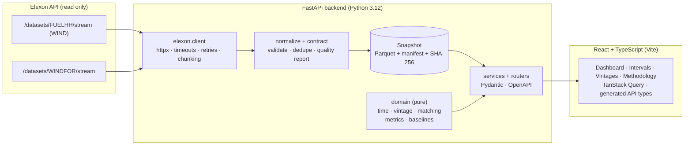

# WindScope UK

[](https://github.com/cycli-city/nkvsr/actions/workflows/ci.yml)
[](https://github.com/cycli-city/nkvsr/actions/workflows/codeql.yml)
[](LICENSE)

**Live app: <https://windscope-uk-sand.vercel.app>** · API docs (Swagger): <https://windscope-api-5joc.onrender.com/api/docs> · how to run it locally: [§10](#10-local-installation--startup)
(the API runs on a free tier and sleeps when idle, so the very first load can take up to a minute)

**Day-ahead wind forecast analytics for GB power procurement.** For every half-hour of a delivery day it shows
the national wind forecast a buyer could actually see at the day-ahead decision cutoff, and quantifies how
accurate that forecast turned out to be, using only Elexon's FUELHH (actuals) and WINDFOR (forecasts) datasets.

> **Status at a glance** (details in [Verification status](#verification-status))
> The analytics engine, API, UI, Docker, CI and tests are built and tested end to end, the **real January 2026 Elexon
> data has been fetched, verified against the live API and committed** (`data/snapshots/current`), and the app is
> **deployed and reachable without a login** (§15). **What is still not done:** the demo video and the owner's own incognito
> check of each URL before submitting the form.

---

## 1. Product overview & problem statement

A UK energy utility buys electricity in the **GB day-ahead market** (auctions close at ~09:20 UK time the day before
delivery). To decide how much firm power to buy beyond what wind will supply, the trading team needs to:

1. **See clearly the latest wind forecast that was available when the day-ahead decision had to be made**, and
2. **Quantify that forecast's accuracy** so the error can be allowed for in the decision.

WindScope answers both for **purchase decisions made in January 2026**, from national WIND data only. It deliberately
does **not** claim to compute purchase volumes: demand, other generation, hedges, storage and balancing are out of
scope, and wind-forecast error is not the utility's net requirement.

The central idea is *information discipline*: every KPI uses only forecasts with `publishTime <= decision cutoff`.
The forecast "as of now" (which includes later revisions) is hindsight, is shown only as a clearly-labelled comparator,
and never feeds a metric.

## 2. Main features

| Area | What you get |
|---|---|
| **Executive summary** | Matched intervals, coverage, MAE, RMSE, bias, WAPE, skill vs a naive baseline, a data-sufficiency indicator, source and last-successful-refresh. Every tile links to the observations behind it. |
| **Decision brief** | For a chosen decision date: the forecast set visible at the cutoff for the next delivery day (mean / peak / trough / energy, which publications it came from) vs hindsight. |
| **Timeline** | Forecast-at-cutoff vs actual on one UK-time axis in MW, zoomable, with tooltips showing publication time and error; optional hindsight overlay. Click a point to open its vintages. |
| **Accuracy analysis** | Daily trend, error distribution, half-hour-of-day profile, day vs night, over- vs under-forecast split, empirical error range, baselines, ten largest misses. |
| **Decision timing** | "Does the decision time matter?": the same analysis re-run with only the cutoff moved to each regular WINDFOR publication run, with the chosen cutoff marked and later runs labelled hindsight. On the January data waiting to the last run of the day lowers MAE by ~10 % but leaves the bias (+1.6 GW) almost untouched. |
| **Interval explorer** | Server-side sortable / filterable / searchable / paginated table (cutoff, publication time, forecast, actual, signed + absolute error, missing-data status) with CSV export. |
| **Vintage comparison** | Every WINDFOR publication for one half-hour, the one eligible at the cutoff marked, with chart and table. |
| **Methodology & data quality** | Sources, the cutoff rule, both readings of "January", metric formulas, ingestion quality report, limitations. |
| **Interpretation switch** | "Decisions made in January" (default) vs "Deliveries in January": never mixed; selectable cutoff (09:20 / 09:50 / 08:00 / custom). |
| **Honest states** | Loading skeletons, cold-start hint, no-data, unreachable API, invalid selection, failed refresh (keeps serving the previous snapshot, clearly dated). Unavailable metrics show "—", never 0. |

## 3. Architecture overview



Key decisions (full ADR log in [`docs/DECISIONS.md`](docs/DECISIONS.md)):

* **Ingest once, serve from a snapshot.** Only the ingestion CLI / optional refresh endpoint talks to Elexon; request
  handlers never do. The API is fast and deterministic, survives upstream outages, and memory is bounded. The snapshot is
  checksummed, atomically replaced, and labelled with provenance and retrieval time.
* **Pure domain layer** (no I/O, no FastAPI): where the correctness risk lives, so it is exhaustively unit-tested.
* **One adapter for upstream assumptions**: `backend/app/elexon/{endpoints,contract}.py`.
* **Contract-first UI**: TypeScript types are *generated* from the backend's OpenAPI document; CI fails on drift.
* **Fast because it is pure**: every analytics response is a function of (snapshot, query), so rendered responses are cached with ETags
  (`304` without computing) and the default dashboard views are pre-computed at start-up (ADR-024/025).
* **Security in layers**: strict CSP on the UI (checked in a real browser), hardening headers and a per-client rate limit on the API, a
  disabled-by-default admin endpoint, least-privilege containers, Dependabot + CodeQL + dependency audits, and a history scanned for secrets.
  Details and honest limits: [`SECURITY.md`](SECURITY.md) (ADR-026/027/029).

## 4. Directory & file structure

```
.
├── README.md                    this file
├── Makefile                     `make help` lists every developer command
├── docker-compose.yml           API + web (+ one-shot `ingest` / `verify` tools)
├── docker-compose.synthetic.yml offline UI demo on clearly-labelled SYNTHETIC data
├── .env.example                 every configuration variable, with safe defaults
├── render.yaml                  API deployment blueprint    (frontend/vercel.json for the UI)
├── SECURITY.md                  security model, what is and is not claimed, how to report a vulnerability
├── LICENSE · CONTRIBUTING.md · CODE_OF_CONDUCT.md · CHANGELOG.md · .editorconfig
├── .github/                     workflows (ci · codeql · dependency-audit), dependabot.yml, PR and issue templates
├── data/snapshots/current/      the committed REAL January 2026 snapshot (Parquet + manifest with SHA-256)
├── docs/                        context · assumptions · architecture · API · live-data verification · deploy · testing · demo kit · real-data findings · requirements traceability
├── backend/
│   ├── Dockerfile · pyproject.toml
│   ├── app/
│   │   ├── main.py · config.py · errors.py · cli.py
│   │   ├── domain/              timeutil · windows · vintage · matching · metrics · baselines · breakdowns
│   │   ├── elexon/              endpoints · contract · client · normalize      (the only upstream-aware code)
│   │   ├── store/               snapshot (Parquet+manifest) · dataset · synthetic (dev only, guarded)
│   │   ├── services/            analysis · ingestion · verification · prewarm
│   │   └── api/                 schemas · deps · middleware (rate limit, response cache) · routes/{analysis,system}
│   └── tests/                   unit · api · integration; deterministic fixtures + one recorded real day (fixtures/real)
└── frontend/
    ├── Dockerfile · nginx.conf.template · vercel.json · csp.ts · playwright.config.ts
    ├── openapi.json             exported API contract → src/api/schema.d.ts (generated)
    ├── e2e/                     Playwright end-to-end + axe accessibility specs
    └── src/
        ├── api/                 typed client, TanStack Query hooks, generated types
        ├── state/useAnalysis    analysis selection ⇄ URL
        ├── lib/                 formatting (UK time), presets, interval query parsing
        ├── components/          layout · ui · states · charts · tables · kpi · panels
        └── pages/               Dashboard · Intervals · Vintages · Methodology
```

## 5. Technology choices & rationale

| Choice | Why |
|---|---|
| **FastAPI + Pydantic v2** | Typed request/response contracts, automatic OpenAPI, validation errors in one envelope. |
| **pandas / NumPy** | `merge_asof` gives "latest publication ≤ cutoff" with exactly one row per interval (no join inflation); vectorised metrics. |
| **httpx** | Async client with explicit timeouts, bounded concurrency and a hand-written retry policy that honours `Retry-After`. |
| **Parquet snapshot, no database** | One bounded month; typed, compact (zstd), checksummed. A database adds infrastructure with no benefit here (ADR-001/013). |
| **React 19 + TypeScript (strict) + Vite** | Fast builds, strict contracts; pages are code-split so charts load only where used. |
| **Tailwind v4** | Design tokens (navy / slate / teal, amber for over-forecast risk) without a component library. |
| **Recharts** | Declarative SVG charts with custom tooltips and keyboard-focusable output. |
| **TanStack Query + React Router** | Caching, retry and loading states; the analysis selection lives in the URL so views are shareable. |
| **nginx (unprivileged) in front of the SPA** | Same-origin `/api` proxy (no CORS), immutable asset caching, security headers, SPA fallback. |

## 6. Elexon API endpoints & data-field interpretation

Base URL `https://data.elexon.co.uk/bmrs/api/v1` (configurable). Datasets named by the brief:

| Dataset | Endpoint | Fields used | Interpretation |
|---|---|---|---|
| FUELHH (actuals) | `GET /datasets/FUELHH/stream?settlementDateFrom&settlementDateTo&fuelType=WIND` | `startTime`, `generation`, `fuelType` (+`publishTime`) | Half-hourly *average MW* (Elexon: "average MW values over 30 minutes"). Rows filtered to `fuelType = WIND` again client-side. |
| WINDFOR (forecasts) | `GET /datasets/WINDFOR/stream?publishDateTimeFrom&publishDateTimeTo` | `startTime` (delivery), `publishTime` (when created), `generation` | **Hourly** values (`startTime` on whole hours), 8 publications a day, each up to 73 hours long. **Delivery time and publication time are never conflated.** |

> ✅ **Verified live on 2026-10-25** (`make verify-upstream` → PASS; evidence in
> [`docs/generated/elexon-verification.md`](docs/generated/elexon-verification.md)): the endpoints, parameters, field names,
> bare-array envelope, UTC `Z` timestamps and January 2026 history all behave as the adapter expects. Two findings shaped the
> product: **WINDFOR is hourly while FUELHH is half-hourly** (handled explicitly, §7), and **the 09:30 publication lands ten
> minutes after the default 09:20 cutoff on every day** (§8). Still *assumptions*, and labelled as such: WINDFOR's unit (MW) and
> exact scope (not stated by Elexon), and which part of the hour a value describes. Full table:
> [`docs/04-DATA-SOURCE-VERIFICATION.md`](docs/04-DATA-SOURCE-VERIFICATION.md).

Ingestion handles upstream errors/timeouts (retry with backoff), missing / malformed / duplicate / out-of-order records,
naive timestamps (rejected, never assumed), off-grid timestamps, and negative values (kept, counted). Dropped rows are counted
**by reason** and shown in the UI; nothing is imputed.

## 7. Forecast-vintage selection methodology

For a delivery interval *i* on local day *D* the **decision cutoff** is `cutoff_local` (default **09:20 Europe/London**) on *D−1*:

```
eligible(i) = { f : f.startTime = block(i)  AND  f.publishTime <= cutoff(D-1) }
used(i)     = the f in eligible(i) with the latest publishTime        (exactly one row per interval)
block(i)    = the forecast hour containing half-hour i               (i itself if forecasts were half-hourly)
```

* **Hourly forecasts vs half-hourly actuals.** WINDFOR has one value per hour. By default (`FORECAST_ALIGNMENT=hold`) each
  forecast hour is applied unchanged to both half-hours it covers; with `exact` only identical start times match and the
  rest are reported as missing. Nothing is interpolated, a half-hour never borrows the *next* hour's value, the cutoff applies
  to the held value, and every API response and screen states the rule in use. *n* counts half-hours that come in pairs
  sharing one forecast. On the January data the choice moves headline MAE by under 1 % ([`docs/09`](docs/09-REAL-DATA-FINDINGS.md) §4).
* Implemented with `pd.merge_asof(by=forecast block start, direction="backward", allow_exact_matches=True)`; a test asserts that
  50+ revisions per interval never change the sample count. Mutation checks confirm that flipping `<=` to `<`, or
  `backward` to `nearest`, fails the suite.
* 09:20 is the **earliest** GB day-ahead gate closure (EPEX SPOT), so nothing unusable at any auction is used. N2EX is
  09:50 per Nord Pool (one secondary source says 09:40), so it is offered as a preset only. A buyer's real deadline is
  earlier than gate closure, so the cutoff is an *upper bound* on what was knowable. This is an **assumption**, surfaced in the UI.
* **Latest-now ≠ at-the-cutoff.** `latest_forecast_mw` (hindsight) and `forecast_mw` (decision-time) are separate fields everywhere; only the latter is used in metrics.
* **"Purchase decisions made in January 2026"** is ambiguous, so both readings are supported and never mixed:

| `basis` | Decision dates | Delivery dates |
|---|---|---|
| `decision_date` (**default**, literal reading) | 1 – 31 Jan 2026 | 2 Jan – 1 Feb 2026 |
| `delivery_date` | 31 Dec 2025 – 30 Jan 2026 | 1 – 31 Jan 2026 |

If the data lacks enough publication history to reconstruct a decision-time forecast, those intervals are reported as
**missing forecast** (visible gaps, counted in coverage); vintages are never fabricated.

## 8. Accuracy metrics & formulas

Sign convention: **error = forecast − actual**. Positive = *over-forecast* (less wind than predicted, so a buyer relying on it would be short).

```
MAE      = (1/n) Σ |e|              RMSE = √((1/n) Σ e²)            Bias = (1/n) Σ e
WAPE     = Σ|e| / Σ actual          (shown only if Σ actual > 0, otherwise "unavailable")
Coverage = matched / expected       (expected = calendar count of half-hours: 46/48/50 per day)
Skill    = 1 − MAE_forecast / MAE_baseline    (on intervals where forecast, actual and baseline all exist)
```

All headline metrics use **one eligible set** (both an actual and a decision-time forecast). Also reported: means, `n`,
missing-forecast / missing-actual / missing-both counts, over/under split, signed and absolute quantiles, a histogram, daily
/ half-hour-slot / day-night breakdowns and the largest misses. MAPE is deliberately omitted (explodes near zero output).
**Baselines** are information-valid at the cutoff: *persistence* (last actual that was complete **and published**, assuming a
30-minute availability lag and never earlier than the record's own publication time, held flat) and *trailing 7-day mean*
(same period over D−8…D−2). Tests assert nothing unavailable at the cutoff can change them.

### Headline results on the real data

Real Elexon snapshot retrieved 2026-10-25; decisions 1–31 Jan 2026 (deliveries 2 Jan–1 Feb), cutoff 09:20, n = 1,488
half-hours, coverage 100 %. Produced by this repository's engine; how to reproduce and everything else in
[`docs/09-REAL-DATA-FINDINGS.md`](docs/09-REAL-DATA-FINDINGS.md).

| MAE | RMSE | Bias (forecast − actual) | WAPE | Over-forecast share | MAE vs persistence / trailing mean |
|---|---|---|---|---|---|
| **2,042 MW** | 2,509 MW | **+1,748 MW** | 18.1 % | 84.7 % of half-hours | 51 % / 54 % lower |

The forecast beats both naive baselines but is **consistently too high**. Whether that is forecast error or a difference in
what WINDFOR and FUELHH WIND each cover cannot be settled with this data (stated on the Methodology page). The result does not
depend on the exact cutoff: every cutoff from 08:00 to 09:29 selects the same 07:30 publication.

## 9. Date & time-zone assumptions

* Everything is UTC internally; `Europe/London` is used only where the *market* is local: delivery days, cutoffs, settlement periods.
* Delivery days have **46 / 48 / 50** half-hours on clock-change days (29 Mar and 25 Oct 2026); tested explicitly, as are BST cutoffs.
* January 2026 is entirely GMT (UK = UTC), so there are no clock changes inside the analysis window.
* The UI always shows UK time with the zone (GMT/BST). Naive timestamps from upstream are rejected, not assumed.

## 10. Local installation & startup

Prerequisites: Python ≥ 3.11, Node ≥ 22. (Docker is optional, see §11.)

```bash
make setup                 # backend venv + frontend deps
cp .env.example .env       # optional; all values have defaults

# Real data (needs internet access to data.elexon.co.uk):
make verify-upstream       # one-off: records the live schema into docs/generated/
make ingest                # writes data/snapshots/current  (commit it for deployment)
make api                   # terminal 1: API on http://localhost:8000
make web                   # terminal 2: UI  on http://localhost:5173

# OR, with no network access: a clearly-labelled SYNTHETIC demo (a red banner shows throughout)
make dev                   # API on synthetic data;  then `make web` in a second terminal
```

## 11. Docker Compose

```bash
docker compose up --build                        # UI+API on http://localhost:8080 (needs data/snapshots/current)
export HOST_UID=$(id -u) HOST_GID=$(id -g)
docker compose --profile tools run --rm ingest   # fetch real data into ./data, then rebuild the image
docker compose --profile tools run --rm verify   # probe the live Elexon API
make up-synthetic                                # offline demo on SYNTHETIC data
```

The nginx container serves the UI and proxies `/api/*` to the API (single origin, no CORS). Both images run as non-root,
have health checks, and the snapshot is baked into the API image so a hosted demo never depends on Elexon being reachable.

## 12. Configuration & environment variables

Everything is environment-driven; see [`.env.example`](.env.example) (placeholders only, no secrets are needed). Highlights:

| Variable | Default | Meaning |
|---|---|---|
| `APP_ENV` | `development` (compose: `production`) | `production` **refuses** synthetic data |
| `DECISION_CUTOFF_LOCAL` | `09:20` | Europe/London cutoff on D−1 |
| `ANALYSIS_MONTH` / `DEFAULT_BASIS` | `2026-01` / `decision_date` | month and interpretation |
| `CORS_ORIGINS` | localhost dev origins | browser origins allowed to call the API |
| `DATA_DIR` | `./data` | snapshots in `$DATA_DIR/snapshots/current` |
| `AUTO_INGEST_ON_START` | `false` | fetch from Elexon on first boot if no snapshot exists |
| `ADMIN_TOKEN` | *(empty)* | ≥16 chars enables `POST /api/admin/refresh`; empty keeps it disabled |
| `ACTUAL_AVAILABILITY_LAG_MINUTES` | `30` | assumed delay before a half-hour's actual is usable (baseline leakage guard; a later recorded publication time always wins) |
| `FORECAST_ALIGNMENT` | `hold` | WINDFOR is hourly, FUELHH half-hourly: `hold` applies each forecast hour to both half-hours it covers, `exact` only matches identical start times (the rest are reported missing) |
| `RATE_LIMIT_PER_MINUTE` | `300` | per-client request budget before HTTP 429 (`0` disables; health checks exempt) |
| `BROWSER_CACHE_SECONDS` | `300` | how long browsers may reuse an analytics response (they also revalidate with an ETag → `304`) |
| `PREWARM_ON_START` | `true` | compute the default dashboard views in the background at start-up |
| `ELEXON_*` | see file | base URL, timeout, retries, backoff, concurrency, chunk sizes |
| `VITE_API_BASE_URL` (frontend build) | *(empty = same-origin)* | absolute API origin when UI and API are on different hosts |

## 13. Running the tests

```bash
make test        # backend pytest + frontend Vitest
make lint        # ruff · mypy --strict · eslint · prettier
make e2e         # Playwright (Chromium): user flows, resilience, responsive, keyboard, axe WCAG 2.1 A/AA
make check       # lint + typecheck + unit/integration tests (what CI runs, minus e2e/docker)
```

Backend tests use deterministic fixtures and a mocked Elexon transport; **no test calls the live API**. See
[`docs/07-TESTING.md`](docs/07-TESTING.md) for what is covered and the mutation checks that prove the key tests have teeth.
Every requirement of the brief, mapped to the code that implements it and the test or run that proves it (and what is still an assumption): [`docs/10-REQUIREMENTS-TRACEABILITY.md`](docs/10-REQUIREMENTS-TRACEABILITY.md).

## 14. API documentation

Run the API and open **`/api/docs`** (Swagger UI) or `/api/openapi.json`. Endpoint guide: [`docs/05-API.md`](docs/05-API.md).

`GET /api/health` · `/api/metadata` · `/api/summary` · `/api/timeseries` · `/api/accuracy` · `/api/cutoff-sensitivity` · `/api/intervals` (+ `/export` CSV) · `/api/forecast-vintages` · `/api/decision-brief` · `POST /api/admin/refresh` (token-guarded, off by default).
Common parameters: `basis`, `from`, `to`, `cutoff`. Every error uses `{"error": {"code", "message", "details"}}` (`429` when the per-client rate limit is exceeded). Analytics responses carry an `ETag` and answer `If-None-Match` with `304`.

## 15. Deployment

| | URL | Status |
|---|---|---|
| Web UI (Vercel) | <https://windscope-uk-sand.vercel.app> | ✅ opens without a login; real data, no synthetic banner |
| API (Render, Docker) | <https://windscope-api-5joc.onrender.com> ([health](https://windscope-api-5joc.onrender.com/api/health) · [docs](https://windscope-api-5joc.onrender.com/api/docs)) | ✅ production mode, real snapshot loaded, CORS limited to the UI |

Deployed on 2026-10-25 and checked **anonymously in a fresh browser profile with no stored state** (28 scripted checks, see
`docs/STATUS.md`), then re-checked after the final redeploy (13 checks, including *no Content-Security-Policy violation on any page*). That is close to, but not literally, an incognito window: the owner still has to open each URL in incognito
before submitting. The API runs on Render's **free tier and sleeps when idle**, so the first request can take about a minute
(the UI says so while it waits). The API is built from the `main` branch (every merge redeploys it). Step-by-step instructions
(including the CORS / `VITE_API_BASE_URL` wiring and a verification checklist) are in
[`docs/06-DEPLOYMENT.md`](docs/06-DEPLOYMENT.md); configs: [`frontend/vercel.json`](frontend/vercel.json),
[`render.yaml`](render.yaml).

## 16. Known limitations & future improvements

* **Still assumptions about the live data** (see §6): WINDFOR's unit (MW; the magnitudes agree with FUELHH but Elexon states none), its scope relative to FUELHH WIND, and which part of the hour an hourly value describes. DST-day behaviour is unit-tested but not covered by real data, because January is entirely GMT.
* Hourly forecasts are applied to both half-hours (§7), so *n* counts half-hours in pairs that share a forecast; the effective sample is about half of *n*.
* Wind only; no demand/price/solar/contract data. Elexon describes FUELHH as generation connected to the transmission system and does not say whether WINDFOR covers the same scope, so part of the observed +1.7 GW bias may be definitional rather than forecast skill.
* The 09:20 cutoff is an upper bound on knowable information; real bid preparation is earlier (use the cutoff selector to test sensitivity).
* One month of history: statistics describe January 2026 and may not generalise across seasons.
* The API image is ~690 MB (pyarrow alone is ~170 MB); switching snapshots to gzip-CSV would remove it at the cost of typed dtypes.
* Ideas: lead-time-bucketed accuracy, multi-month ingestion with a scheduled refresh, quantile-forecast comparison, an ENTSO-E/price overlay (explicitly out of scope today), authenticated multi-user views.

## 17. AI assistance disclosure

**AI tools were used extensively to build this project.** The code, tests, configuration and documentation were produced with
Anthropic's **Claude Code** (an AI coding assistant) working interactively with the repository owner, who set the requirements
and priorities. The AI also performed browser-based QA and iterative debugging. All output is reviewable in the Git history
and was verified by running the test suites, linters, type-checkers, containers and a real browser (see [Verification status](#verification-status)).

---

## Verification status

What has **actually been run and observed** (not just written):

| Check | Result |
|---|---|
| Backend: `pytest` (unit, API, mocked-Elexon end-to-end ingestion, recorded real responses) | ✅ passing (358 tests) |
| Backend: `ruff`, `ruff format --check`, `mypy --strict` | ✅ clean |
| Backend mutation checks (cutoff `<=`, `backward`, error sign, baseline lag, forecast-hour rounding, publication-time rule) | ✅ each caught by tests |
| Frontend: `tsc --strict`, `eslint`, `prettier --check`, Vitest | ✅ clean / 98 passing |
| Frontend: Playwright E2E + axe + CSP-violation sweep (Chromium, production build, real API) | ✅ 48 passing (on the labelled synthetic snapshot) |
| **Live acceptance test** (`npm run uat`: every control of the deployed site, real data, phone/tablet/keyboard) | ✅ 80 of 80 checks + 17 of 17 API checks; found and fixed two timeline-zoom defects. Report: [`docs/11-UAT-REPORT.md`](docs/11-UAT-REPORT.md) |
| Docker: API and web images build; run non-root; healthy; production refuses synthetic data | ✅ |
| Docker Compose stack: service discovery, health-gated start, browser → nginx → API | ✅ (run on synthetic data) |
| **Live Elexon API: schema, parameters, history coverage** | ✅ **`make verify-upstream` PASS on 2026-10-25**; WINDFOR unit and scope remain assumptions |
| **Real January 2026 snapshot** | ✅ **ingested and committed** (`data/snapshots/current`); results in [`docs/09`](docs/09-REAL-DATA-FINDINGS.md) |
| GitHub Actions CI | ✅ run 9 (`e8ccab6`, security + performance + decision-timing work): all 5 jobs passed; CodeQL (Python, TypeScript) and the dependency audit also passed. An earlier run had caught a real 320 px layout bug (fixed). Details: `docs/STATUS.md` |
| **Vercel / Render deployment** | ✅ deployed 2026-10-25; 28 anonymous checks in a fresh browser profile (API health/metadata/docs, CORS allow- and deny-lists, admin endpoint disabled, real numbers on the dashboard, deep links, URL-restores-view, axe WCAG 2.1 A/AA, security headers, no horizontal scroll at 390 px, no console errors) |
| **Owner's incognito check of each URL, demo video, form** | ❌ **still to do: see `docs/06-DEPLOYMENT.md` §6, `docs/08-DEMO-GUIDE.md`** |

The browser (Playwright) tests and CI's Compose smoke test run on a **synthetic** snapshot, which is stamped, banner-labelled and
refused in production; those numbers are never results. The figures in this README come from the real snapshot.

## License

The code and documentation are released under the [MIT License](LICENSE). The **data** is not covered by it: Elexon BMRS data is used under
[Elexon's data licence](https://www.elexon.co.uk/data/balancing-mechanism-reporting-agent/copyright-licence-bmrs-data/), and the committed
snapshot in `data/snapshots/current` carries that attribution. Contributions: see [CONTRIBUTING.md](CONTRIBUTING.md); changes: [CHANGELOG.md](CHANGELOG.md).

*Contains BMRS data © Elexon Limited copyright and database right.*
