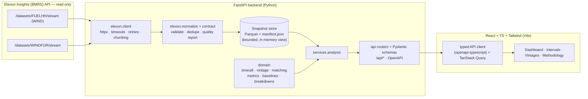

# 03 — Architecture

## System overview



## Key design decisions (see `DECISIONS.md` for rationale)

* **Ingest once, serve from a snapshot.** Elexon is only contacted by the ingestion pipeline (CLI, optional
  startup auto-ingest, or token-guarded refresh endpoint). Request handlers never call Elexon. This keeps the
  API fast, deterministic, immune to upstream outages, and bounded in memory. The snapshot is labelled with
  provenance + retrieval time; if a refresh fails the app keeps serving the last good snapshot and says so.
* **Pure domain layer.** `app/domain/*` has no I/O and no FastAPI imports: DataFrames/arrays in, results out.
  This is where the correctness risk lives, so it is exhaustively unit-tested with deterministic fixtures.
* **One adapter for upstream specifics.** Dataset names, parameter names, chunk sizes and field contracts live
  in `app/elexon/endpoints.py` and `contract.py`. If the live schema differs from the documentation-based
  assumptions, the fix is confined to those files and the contract check fails loudly (never silently).
* **UTC everywhere internally**, `Europe/London` only at the edges (delivery-day grouping, cutoff
  construction, UI formatting).
* **Responses are cached because they are pure.** Every analytics body is a function of (snapshot, settings, query), so a small
  pure-ASGI middleware keeps the rendered, compressed JSON (bounded: 256 entries / 32 MB) and answers `If-None-Match` with `304`
  without computing anything. The default dashboard views are computed in the background at start-up, so the first visitor on a
  small free-tier host is not the one who pays for pandas (measured on Render's free plan, see ADR-024: uncached 0.3–1.0 s per view and ~3 s for decision timing; cached ≈ 0.25 s, the network round trip).
* **Middleware order matters.** Request path: access log + security headers → CORS → rate limiter → response cache → gzip → routes.
  CORS wraps the limiter and the cache so `429`, `304` and cached responses all carry the right `Access-Control-*` headers for the
  asking origin, and the cache never stores them (a tested guarantee).
* **Abuse protection is layered, and honest about its limits.** The app limits per client (first `X-Forwarded-For` hop: a client can
  spoof it to evade *its own* limit but cannot spend anyone else's, whereas trusting the right-most hop would make all users share
  one bucket behind a two-proxy platform). Network-level abuse is the edge's job; the free Render tier sits behind Cloudflare.
* **Decision-time vs hindsight kept separate** in every response: `forecast_mw` (eligible at cutoff) and
  `latest_forecast_mw` (latest published, hindsight) are distinct fields; metrics use the former only.

## Backend module map

```
backend/app/
  main.py            app factory, lifespan (load snapshot, background pre-warm), middleware stack, security headers, exception handlers
  config.py          pydantic-settings (env-driven)
  errors.py          typed application errors → consistent JSON error envelope
  domain/            timeutil · vintage · matching · metrics · baselines · breakdowns · windows
  elexon/            endpoints · client · normalize · contract
  store/             snapshot (parquet+manifest) · dataset (in-memory view) · synthetic (dev only)
  services/          analysis (query → results) · ingestion (fetch→normalise→persist) · prewarm (default dashboard views at start-up)
  api/               schemas · deps · middleware (rate limit, response cache) · routes/*
  cli.py             ingest · verify-upstream · generate-synthetic-dev · export-openapi
```

## API surface

| Method & path | Purpose |
|---|---|
| `GET /api/health` | Liveness + whether a dataset is loaded |
| `GET /api/metadata` | Provenance, snapshot manifest, last refresh/attempt, bases + windows, cutoff presets, units, thresholds |
| `GET /api/summary` | Executive KPIs: metrics, coverage, data-quality status, baseline skill, over/under split |
| `GET /api/timeseries` | Per-interval forecast (at cutoff) / latest forecast / actual / error |
| `GET /api/accuracy` | Breakdowns: daily, by settlement period, day/night, histogram, largest errors |
| `GET /api/intervals` | Paginated, sortable, filterable interval table (+ CSV export) |
| `GET /api/forecast-vintages` | All publications for one delivery interval + selected-at-cutoff marker |
| `GET /api/cutoff-sensitivity` | The analysis repeated with only the cutoff moved (one point per regular publication run + the chosen cutoff) |
| `GET /api/decision-brief` | The forecast set visible at one decision cutoff for the next delivery day |
| `POST /api/admin/refresh` | Token-guarded re-ingest (disabled unless `ADMIN_TOKEN` set) |

Common query parameters: `basis` (`decision_date`|`delivery_date`), `from`, `to` (dates in the basis' date
type), `cutoff` (`HH:MM` Europe/London). Errors: `{"error": {"code", "message", "details"}}`.

## Frontend structure

```
frontend/src/
  api/         client.ts · schema.d.ts (generated) · hooks.ts
  state/       analysis params in URL (basis, from, to, cutoff)
  components/  layout · ui primitives · charts · tables · states
  pages/       Dashboard · Intervals · Vintages · Methodology
  lib/         formatting (UK time, MW) · errors
```

## Deployment topology

```
Vercel (static Vite build)  ──HTTPS──▶  Render/other (Docker, FastAPI + committed Parquet snapshot)
                                              └─(optional, off by default)─▶ Elexon API
```

The snapshot is baked into the backend image, so the hosted demo never depends on Elexon being reachable and
never serves anything but labelled, previously retrieved data.
